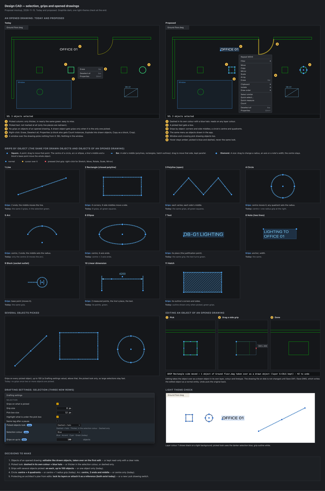

# UI UX proposal – Design CAD selection, grips and opened drawings (2026-11-15)

Status: **proposal, waiting for approval.** Nothing is built yet.

The user noticed two things on 2026-11-15. First, objects of a drawing opened from outside (DXF / DWG) do not edit or right-click like objects drawn in the app. Second, a picked object does not look picked, and there are no grips that suit the object (a rectangle's corners, a circle's centre).

Mockup: `docs/mockups/cad-selection-grips-mockup.html` (image: `cad-selection-grips-mockup.png`).

## Today

### Objects of an opened drawing are read-only

The app never changes the opened file. Only objects drawn in the app (drawn objects) and devices can be edited. An object of the opened drawing (`dw:<handle>`) can only be:

- picked by a click or a Shift-click (`pick`, `src/components/cad/CadPage.tsx:1576`); Properties then shows read-only details;
- erased. This only adds its handle to `project.cadErased` (`CadPage.tsx:1366`), and RESTOREDWG brings it back;
- if it is a block: Count instances, Explode into drawn objects, Copy as a block of this drawing, or Crop.

| | Drawn in the app | Object of an opened drawing |
|---|---|---|
| Right-click | full menu: Move, Copy, Rotate, Mirror, Offset, Trim, Clipboard, Isolate, Draw order, Select similar, Quick measure, Properties… | Erase, Deselect all, Properties (`drawingObjectMenu`, `src/components/cad/cadSheetMenus.ts:21`, from `contextAt`, `CadPage.tsx:1670`) |
| Window / crossing | picks them | never picks them (`pickWindow`, `CadPage.tsx:1594`, passes on devices and drawn objects only) |
| Move, Copy, Rotate, Scale, Stretch… | yes | no |
| Grips | yes (one object only) | none |
| Properties palette | editable | read-only details |
| Isolate / Hide objects | yes | left as they are (`hideObjects`, `CadPage.tsx:1716`) |

### Picked objects hardly look picked

- A picked drawn object is redrawn 3 px wide in `--cad-snap`, which is `--ok` (green #37d67a on Graphite dark; `src/components/cad/CadCanvas.tsx:467`). A picked object of the opened drawing has its line pieces drawn again in the same way (`CadCanvas.tsx:429`).
- The same green is used for snap markers and grips. It is also close to colour 3 (green), a common layer colour for walls and columns. On those layers a pick only makes the line thicker, which is easy to miss. A drawn object with a 0.5 mm lineweight (lineweights shown) is already 3 px wide, so on a green layer a pick changes almost nothing.
- A picked **text** of an opened drawing gets no mark at all. Texts are drawn separately (`CadCanvas.tsx:676`), and the highlight only redraws line pieces.
- Only the colour changes. There is no dash or halo to fall back on when the layer colour is close to the green.

### Grips

- Grips show only for **one drawn object** while no command is running (`CadPage.tsx:4074`: `selSketch && !many`). There are none when two or more objects are picked, and none for objects of an opened drawing.
- Every grip is the same green square as the snap marker (`CadCanvas.tsx:796`).
- By kind (`gripsOf`, `src/model/cadEdit.ts:337`): a line or polyline (including a rectangle) has its vertices and the middle of each side, which is fine. A circle has its centre and one radius grip at the right. An arc has **only its centre**. An ellipse has its centre and 2 axis ends. Texts and blocks have their insertion point, a note has its anchor and width, and a dimension has its points.

## Proposed

### 1. Objects of an opened drawing edit like drawn objects

- They get the same right-click menu, floating edit toolbar, typed commands, grips, clipboard, Properties palette and Isolate / Hide as drawn objects. Window and crossing pick them too.
- **The first edit takes them over.** Picking stays as fast as today. When an edit changes the picked objects (Move, a grip drag, Stretch, a property…), they become drawn objects with the same layer, colour, linetype, lineweight and exact geometry, and the originals are erased by handle. Block Explode already works this way (`explodeObjects`, `engines/cad-reader/src/doc.rs:1270`; `defFromPieces`, `src/model/cadBlockLibrary.ts:64`; `CadPage.tsx:1839`). Copy keeps the original and adds a drawn copy. One ⌘Z undoes both the take-over and the edit.
- The file on disk stays unchanged until Save DXF / Save DWG. Saving already writes drawn objects and leaves out erased handles, so an edited object is saved as a normal entity (with a new handle).
- The command line reports it, for example: `MOVE  3 objects of Ground floor.dwg taken over as drawn objects and moved · ⌘Z to undo`.
- Locked layers stay locked: the edit is refused with the LAYULK hint, as it is for drawn objects. To keep an architect's plan safe, lock its layers (LAYLCK) or attach it as a reference (XATTACH). Both already exist.
- What a faithful take-over still needs: today `defFromPieces` keeps only the layer and colour (`:73`) and drops polyline arc segments (`:78`). It should keep bulges, linetype and lineweight. An MTEXT should become a note, an ellipse an ellipse, a patterned hatch should keep its pattern, and a dimension should become a drawn dimension. Splines become polylines, and the status line says so.

### 2. A picked look that reads on any colour

- A picked object is drawn dashed in its own colour (6 px on, 4 px off) over a 6 px halo in the selection colour at 35 %.
- A picked text or note gets a box 3 px around it, tinted 18 % and outlined dashed. A picked hatch gets a dashed outline, the halo and a 15 % tint.
- The selection colour is blue: #4aa8ff on dark themes and #1D5FBF on light ones. The selection window already uses blue. Hover stays amber (approved 2026-11-13), so hovered and picked objects never look alike.
- Drawn objects and objects of an opened drawing get the same look. Devices keep their own marks.

### 3. Grips that suit the object

Three shapes show what each grip does:

- **Square**: a point. Dragging it moves that point. The centre of a circle, arc or ellipse, a line's middle and a block's base point move the whole object.
- **Bar** (along the side): the middle of a side on a polyline, rectangle or hatch outline. Dragging it moves that side and keeps it parallel.
- **Diamond**: a size (a radius, an axis or a note's width). The centre stays put.

Colours: blue normally, amber under the cursor (as today), red when pressed. A pressed grip is the hot grip, and its right-click menu has Stretch, Move, Rotate, Scale and Mirror.

| Object | Proposed grips | Today |
|---|---|---|
| Line | 2 ends + middle | same |
| Rectangle / polyline | each vertex + each side's middle (bar) | same, all squares |
| Circle | centre + 4 quadrants | centre + 1 at the right |
| Arc | centre + 2 ends + middle (radius) | centre only |
| Ellipse | centre + 4 axis ends | centre + 2 |
| Text | its place (justification point) | same |
| Note | anchor + width | same |
| Block | base point | same |
| Dimension | 2 measured points, the line's place, the text | its points |
| Hatch | outline corners + side middles | same, shown when picked |

- With several objects picked, each one gets its grips, up to 100 objects (a Drafting settings value). Above that only the picked look shows, so large selections stay fast. Dragging a grip edits only the object it belongs to.
- While a command runs, grips stay as they are today (none).

### 4. Drafting settings → Selection: three new rows

- Picked objects look: Dashed + halo / Thicker, in the selection colour / Dashed only.
- Selection colour: Blue / Accent / Cyan / Green.
- Grips on up to: 100 objects.

## Decisions

1. Objects of an opened drawing: **editable like drawn objects, taken over on the first edit**, or kept read-only with a clear note?
2. Picked look: **dashed in its own colour + blue halo**, thicker in the selection colour, or dashed only?
3. Grips with several objects picked: **on each, up to 100 objects**, or one object only (as today)?
4. Circle: **centre + 4 quadrants**, and arc: **centre, 2 ends and middle**, or keep today's grips?
5. Protecting an architect's plan: **lock its layers or attach it as a reference (both exist)**, or add a new Lock drawing switch?

## Steps once approved

1. **Picked look and grips.** Only the canvas and `gripsOf` / `gripMoved` change; no engine change. The halo and dash for drawn objects and objects of an opened drawing, including texts and hatches; grip shapes and colours; circle quadrants, arc ends and middle, all 4 ellipse axis ends; grips on several objects; the three settings rows. Tests for each grip kind.
2. **Objects of an opened drawing edit like drawn ones.** The drawn-object menu and toolbar for `dw:` picks. Window and crossing picks, which need an engine window query (a Rust change and `npm run build:cad`). Take-over on the first edit, with undo. Grips for picked drawing objects, read from the drawing for those objects only (as Crop does). Bulges, linetype and lineweight kept. Tests: take-over, undo, saving to DXF with the edit, refusal on a locked layer.
3. **Faithful take-over of the remaining kinds.** MTEXT, ellipse, patterned hatch and dimension, with the engine pieces carrying what each needs; splines as polylines.

Speed: step 2 reads the picked objects from the drawing's bytes, as Crop and Explode do. Measure this on the largest sample drawing before wiring it to every pick.

Related: [[UI UX proposals - 2026-11-13 - CAD cursor and pick box]], [[UI UX proposals - 2026-11-11 - Context-aware right-click menus]].
