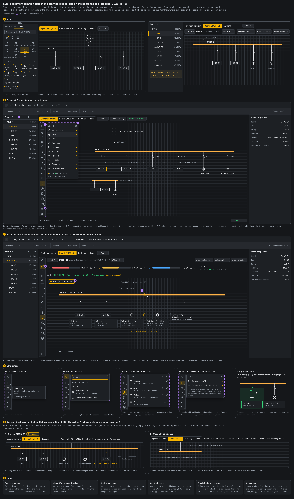

# UI UX proposal – SLD equipment strip, and equipment on the Board tab (2026-11-15)

Status: **proposal.** The user answered decisions 1–4 and 6 on 2026-11-15 (see Decisions); decision 5 is open. Nothing is built.

Mockup: `docs/mockups/sld-equipment-strip-mockup.html` (image: `sld-equipment-strip-mockup.png`).

The user's request: the equipment library is a wide panel and they do not like it; they asked for a small, thin, long strip instead. They can add equipment on the System diagram, but not on one board's own diagram (the Board tab), because the library is not there.

## Today

- The library is the second tab of the side panel, "Equipment", beside "Panels" (`PanelTree`'s `equipment` prop, `EquipmentPalette` docked). The panel is 230 px wide by default. It holds the search box, a favourites and recently used row, 11 category tiles four across, then the open category as tiles four across (Loads: 10 tiles in 3 rows).
- `App.tsx` passes the library only when `view === 'design' && diagramMode === 'system' && !sldFull`. In full screen the undocked library (`equipment(false)`) floats inside `.sld-edit`.
- The Board tab (`BoardSheetView`) draws with `SingleLineDiagram`, which takes no drops: no `onDropItem`, no busbar hit line, no click for an armed item. Only `SystemDiagram` takes drops.
- The ribbon's Supply and Devices menus arm the same items, but first switch to the System diagram (`system()` in the `sld.onArm` handler in `App.tsx`).
- The 2026-10-23 library proposal listed a collapsed rail as item 7 ("optional, later": a 46 px icon rail with a list per category). It was not built. This proposal makes that rail the library itself.

## Proposed

### 1. A 44 px equipment strip

On the System and Board tabs, a 44 px strip on the left edge of the drawing, from under the diagram tabs down to the results drawer. A button at its foot moves it to the right edge and back; the app remembers the side. On the right, its lists open to the left.

- Top to bottom: Search; favourites ★ and recently used (the same 8 as today's row, fewer on a short window; the mockup draws 4); the categories as their symbols, the same as today's category tiles (11, or 10 when the database holds no equipment of your own); at the foot, Move to the other side and Hide.
- Category names and counts are in the hover tooltip ("Boards · 12").
- Clicking a category opens its list beside the strip, one column: symbol, name, where-it-drops dots. Feeder presets, My presets and Components open a wider list (about 270 px) for their two-line cards with edit, copy and delete.
- Clicking an item closes the list and arms it: the next click on the drawing places it. Drag works as today. A pin in the list's header keeps it open, to place several kinds.
- While an item is armed it is lit in the recent row, and a small chip at the drawing's top-left holds the × qty stepper (today it is on the armed tile) and Esc.
- Search opens the same list with the search field, with results from every category.
- The side panel shows Panels only. There is no Equipment tab, so you can change board while placing.
- On a short window the recent row folds first, then the strip scrolls. The strip with 4 recent items is about 580 px tall; with 8, about 700 px.
- Full screen uses the same strip instead of today's floating library.

The drawing gains about 186 px of width (230 px tab to 44 px strip).

### 2. Equipment on the Board tab

The same strip is on the Board tab. The board's own drawing takes drops and clicks:

- **On the busbar:** a new way on this board, where the marker shows (between two ways, with `before` as on the System diagram). This covers loads, boards, presets, components, My equipment, capacitor bank, SPD, PMU and generator.
- **On a way:** breaker type, kWh or CT meter, RCD, local isolator, cable type or cable edit on that circuit. A starter goes only on a motor way.
- **Hidden items:** the lists and search show only what this board can take, on its busbar or on one of its ways. On a sub-main board such as SMDB-G1, Supply lists only the two generators: Transformer and Bus coupler / tie (main boards only) and Meter cabinet (only on the System diagram's empty canvas) are not listed, nor MDB, LV-MDB and LV-ACB (only under a meter cabinet). A category with nothing for this board leaves the strip, such as Starters on a board with no motor way. The check is `canDrop` against this board's busbar and its ways. The System diagram lists everything.
- **After a drop:** a dropped load, device or meter never changes the board on screen. For a dropped board or board preset, see decision 5: today `showResult` selects a new board, which on the Board tab would jump to it.
- **Final circuits:** a small single-phase way (20 A or less, `SLD_FINAL_CIRCUIT_MAX_A`) is not drawn on its own unless Show final circuits is on. It joins the "see the DB load schedule" box, and the status line says so.
- **Ribbon:** with the Board tab open, an item from Supply or Devices that this board can take stays on the Board tab. The others (Meter cabinet always; Transformer and Bus coupler on a board that is not a main board) switch to the System diagram as today.

## What stays the same

- Every item, its symbol, name and drop rules (`PALETTE`, `dropsOn`, `canDrop`, `dropMany`); breaker and cable sizing; undo.
- Favourites, recent and their preference keys (`palette.cat`, `palette.favs`, `palette.recent`), so saved favourites carry over.
- Preset and component editing, import and export, the hover card, shift-click × 3 and Esc.
- The Board tab's bar, phase loading, earth row, drawing and circuit table.
- Colours, fonts and tokens.

## Suggested steps

1. The strip and its lists on the System diagram, with the left / right switch. They replace the Equipment tab and the full-screen floating library.
2. Drops and clicks on the Board tab's drawing, hidden items and categories, decision 5, and the ribbon's Supply and Devices staying on the Board tab.

## Decisions

Answered by the user on 2026-11-15, except 5.

1. Remove the side panel's Equipment tab once the strip is there? **Yes.**
2. Strip on the left or the right edge of the drawing? **The user chooses: left by default; a button at the strip's foot moves it to the right and back, and the app remembers the side.**
3. Icons only (44 px), or short names under the symbols (about 72 px)? **Icons only, with names in the hover tooltip.**
4. After a pick, close the list or keep it open? **Close, with a pin in the list's header to keep it open.**
5. **Open.** On the Board tab, a DB dropped on SMDB-G1's busbar makes a new board, DB-G3. Should the screen stay on SMDB-G1 with the new way selected (A, suggested), or open DB-G3 at once (B)? Drawn as section 5 of the mockup. A dropped load, device or meter never changes the board on screen, so this applies only to boards and board presets.
6. Items this board cannot take: greyed or hidden? **Hidden**: an item is listed only where it can be used, and a category with nothing for this board leaves the strip. (Greyed had been suggested.)

## Implementation notes (if approved)

- `src/components/EquipmentPalette.tsx`: the strip and list layout, the open-list state, close on arm, the pin (new preference key `palette.pin`), the side (new key `palette.side`), and the placing chip with × qty. The tile grid goes.
- `src/App.tsx`: mount the strip beside `SystemDiagram` and `BoardSheetView`, on the chosen side; remove `equipment` from `PanelTree`; full screen uses the strip; `showResult` on the Board tab as decision 5 settles; the ribbon's `onArm` does not call `system()` there for items the board can take.
- `src/components/SingleLineDiagram.tsx` and `BoardSheetView.tsx`: a busbar hit line with the insert position (from the pointer between way centres), way targets, the armed click and `onDropItem`, with the same classes as `SystemDiagram` (`bus-hit`, drop highlight).
- `src/model/sldEdit.ts`: a helper for whether a board can take an item (its busbar or any of its ways) using `canDrop`, used on the Board tab to hide items and empty categories.
- `src/styles.css`: strip and list rules with the existing tokens only.
- Tests: strip open, close, pin and arm; left / right side; search; Board tab drop on the busbar with `before` and on a way; hidden items and categories; decision 5; the ribbon arm on the Board tab; the existing library tests updated.
- Manual: the SLD text and captures that show the side panel.
