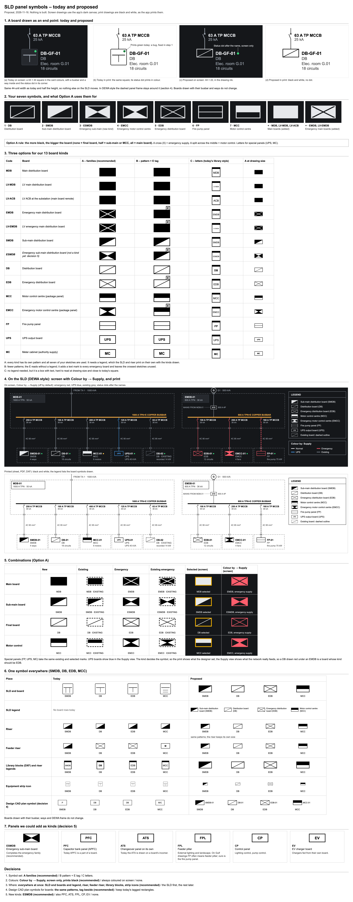

# UI UX proposal – SLD panel symbols (2026-11-16)

Status: **proposal; decision 6 answered, decisions 1–5 waiting.** Nothing is built. Main boards changed on 2026-11-16 after the user's feedback: all filled is dropped, and the user chose M1, the double frame (see Main boards under Option A, and mockup section 2b).

Mockup: `docs/mockups/sld-panel-symbols-mockup.html` (image: `sld-panel-symbols-mockup.png`).

The user's request: they sent seven board symbols: 2:1 rectangles with one diagonal, a half filled on the diagonal, crossed with the left and right or the top and bottom filled, crossed, split across the middle, and the top half filled. They said the SLD's square board box is not what anyone draws on an SLD. They asked which symbol fits which of our panels, how to show combinations (an emergency MCC, an existing board), whether colours help, and for a mockup with options.

## What the standards say

- IEC 60617 has one general symbol for a switchboard, distribution board or panel. The panel type is told by a pattern of blocks or by letters, and the drawing's own legend says which is which. In the UK, BS EN 60617 replaced BS 3939. No standard says "half filled = SMDB".
- So the user's patterns fit the standard: the general panel symbol, told apart by its pattern. They print in black and white. The meanings are ours to choose, but every drawing that uses them must print a legend.
- On an SLD, a board that has outgoing ways is drawn as its busbar, with its incomer and ways, inside the DEWA dashed frame. The app already does this, and it stays. The pattern symbol is for a board drawn as an end point (no ways drawn), for risers, for plans and for legends.

## Today

The app draws the same board five different ways:

1. **SLD end board** (`BoardSymbol` in `SystemDiagram.tsx`): a 44 × 44 square with a busbar inside. It has one way (DB, EDB), two ways (MDB, SMDB, EMDB, …) or two control rows (MCC, EMCC, FP). The kind shows only in these small inner marks and the text beside the square. On screen the square has the card colours (fill `--p2` #26292E, edge `--line` #353A41), so it reads as an app tile, not a drawing symbol. This is the square the user dislikes.
2. **IEC symbol library** (`symbolLibrary.tsx`; DXF blocks and the riser legends): `p-mdb`, `p-smdb`, `p-db`, `p-edb`, `p-mcc` and `p-apfc` are upright boxes with a filled top strip and the code letters.
3. **Riser** (`RiserDiagram.tsx`): every board is one rectangle with its lower-right half filled.
4. **Feeder riser** (`FeederRiserDiagram.tsx`): DB and EDB are crossed (X), SMDB is half filled, MCC is "M" and UPS is "UPS". A crossed symbol for a normal DB conflicts with X meaning emergency in this proposal.
5. **Design CAD plan symbols** (`planSymbols.ts`): a rectangle with its tag (MDB, DB, P, M/C).

Also:

- The SLD legend (`legendEntries`) has no board rows.
- **Bug: the end board's status dot prints.** The print and CAD export removes `.status-dot`, but the dot in the end-board square has no class. It prints green (#13803d), amber or red on the black-and-white sheet. I checked this by rendering an end board through `printableSvg`: the circle is kept with `fill:#13803d`. Adding the class fixes it (one line), with or without this proposal.
- The SVG-to-DXF converter writes rectangles and polygons as outlines, and it skips shapes with no stroke. Filled patterns need a DXF SOLID for each fill. Every fill below is a triangle or a rectangle, which is exactly one SOLID.

## Proposed

### 1. One symbol, a 2:1 rectangle

- On the SLD it is 44 × 22 units: the width of today's square and half its height, so nothing else on the SLD moves. The name, kind, place and tags stay where they are, on its right.
- It is drawn in the drawing ink: light on the dark canvas, black on paper. Fills use the same ink. Outline 1.5, inner lines 1.2.
- The status dot moves after the name, outside the symbol, with the `status-dot` class, so it never prints.
- Selected: amber outline, as today.

### 2. Option A – families (recommended)

One rule: **the fill shows the level (none = final board, half = sub-main or MCC) and a double frame marks a main board; a cross (X) = emergency supply; a split across the middle = motor control; letters for special panels.**

| Kind | Board | Option A symbol |
|---|---|---|
| MDB, LV-MDB, LV-ACB | Main board | The SMDB symbol inside a second frame (double frame) |
| EMDB, LV-EMDB | Emergency main board | The ESMDB symbol inside a second frame |
| SMDB | Sub-main board | One diagonal, upper-left half filled (sketch 2) |
| ESMDB (new kind, decision 5) | Emergency sub-main board | Cross, left and right filled (sketch 3) |
| DB | Distribution board | One diagonal (sketch 1) |
| EDB | Emergency distribution board | Cross (sketch 5) |
| MCC | Motor control centre | Top half filled (sketch 7) |
| EMCC | Emergency MCC | Cross, top and bottom filled (sketch 4) |
| FP | Fire pump panel | Split across the middle (sketch 6) |
| UPS | UPS output board | Letters UPS |
| MC | Meter cabinet | Letters MC |

All seven of the user's sketches are used. The main boards add a second frame inside the outline, 3 units in.

**Main boards (the user's feedback, 2026-11-16).** The first draft drew main boards all filled (emergency: all filled with a white cross). The user did not want it: a solid block prints as a heavy black patch, and its edge is lost in a black-and-white print. They suggested the ESMDB-style symbol with something to mark it as the main board, or another option. Four options are in mockup section 2b:

- **M1 – double frame (chosen by the user on 2026-11-16):** the sub-main symbol with a second frame. MDB comes from SMDB and EMDB from ESMDB, so a cross still means emergency. It uses half the ink of the block, and it is two rectangles in DXF.
- **M2 – letters:** MDB and EMDB written in the box, like UPS and MC. Clear, but it is text at drawing size, and a main board then looks like a special panel.
- **M3 – hatched:** thin 45° lines that print light grey and export to DXF as plain lines. Busy at small sizes, and the emergency cross is hard to see through the hatch.
- **M4 – bow-tie:** the user's first idea taken literally: the main board takes the cross with its sides filled. Then a cross no longer means emergency, so EMDB and ESMDB need an E tag instead.

An existing main board keeps the inner frame solid and draws the outer frame dashed.

### 3. Option B – pattern + E tag

The normal patterns of Option A, with emergency shown as a small "E" box on the symbol's top edge at its right end (EDB = DB + E, EMCC = MCC + E, EMDB = MDB + E). It covers any future combination without a new pattern, and it reads without a legend. It adds a text mark to every emergency symbol and does not use the crossed sketches.

### 4. Option C – letters

The library's style: a box with a filled top strip and the code (MDB, SMDB, DB, EDB, MCC …). It needs no legend, but it is a box with text, close to what the user dislikes, and the codes are hard to read at drawing size.

### 5. Combinations (all options)

- **Existing:** dashed outline, fills kept 2.5 units inside it so the dashes show, and "· EXISTING" after the kind as today.
- **Emergency:** from the board kind (EDB, EMDB, LV-EMDB, EMCC, ESMDB). The kind decides the symbol, so the designer controls what prints.
- **On a generator or a UPS:** the generator and ATS stay drawn on the incomer as today. The colour view below shows the supply a board really gets from the network.
- **Selected and check status:** screen only, as in 1.

### 6. Colours: on screen only

A new **Colour by → Supply** choice, beside Voltage drop, Breaker loading and the others. It colours board symbols and their cables by the supply the network gives them: normal in the drawing ink, emergency red (below a generator changeover or an emergency board), UPS blue (below a UPS board) and existing grey. Busbars keep their own colour. It is off by default. The sheet, PDF and DXF print it black, so the patterns carry the meaning on paper. On screen, a DB drawn red under an EMDB shows a board whose kind should be EDB.

### 7. One symbol everywhere

The same set on the SLD end boards, in a new SLD legend row for each kind drawn, on the riser and the feeder riser, as the library's panel blocks (DXF) and the riser legends, as the equipment strip's board icons, and (decision 4) as the Design CAD plan symbols for boards. Boards drawn with their busbar do not change.

### 8. Panels we could add as kinds

| Code | Panel | Symbol (Option A) |
|---|---|---|
| ESMDB | Emergency sub-main board | Cross, left and right filled |
| PFC | Capacitor bank panel (APFC) | Letters PFC |
| ATS | Changeover panel on its own | Letters ATS |
| FPL | Feeder pillar (external lighting, landscape) | Letters FPL. On Gulf drawings "FP" often means feeder pillar, but our FP is the fire pump panel. |
| CP | Control panel (lighting control, pumps) | Letters CP |
| EV | EV charger board | Letters EV |

## What stays the same

- Boards drawn with their busbar, ways and DEWA frame; the incomer devices; the text beside an end board; the layout.
- The board kinds, their names and the data model (unless decision 5 adds kinds).
- Print stays black and white.

## Decisions

1. **Symbol set:** A families (recommended) / B pattern + E tag / C letters.
2. **Colours:** Colour by → Supply, screen only, prints black (recommended) / always coloured on screen / none.
3. **Where:** everywhere at once: SLD end boards and legend, riser, feeder riser, library blocks and strip icons (recommended) / the SLD first, the rest later.
4. **Design CAD plan symbols for boards:** the same patterns, with the tag beside them (recommended) / keep today's tagged rectangles.
5. **New kinds:** ESMDB (recommended, completes the emergency family) / also PFC, ATS, FPL, CP, EV / none.
6. **Main boards (MDB, LV-MDB, LV-ACB, EMDB, LV-EMDB):** answered 2026-11-16: **M1 double frame** (not M2 letters, M3 hatched or M4 bow-tie).

## Suggested steps after approval

1. One board-symbol module drawing every pattern, used by the SLD end board and a legend row per kind drawn, with fills as DXF SOLIDs, and the status dot moved and classed.
2. The riser, feeder riser, library panel blocks and strip icons.
3. Colour by → Supply.
4. Plan symbols and new kinds, as decided.

Tests: one symbol per kind; the DXF has one SOLID per fill; the printed SVG has no status dot; the legend lists only the kinds drawn; the end board keeps its 44-unit width and text positions.
