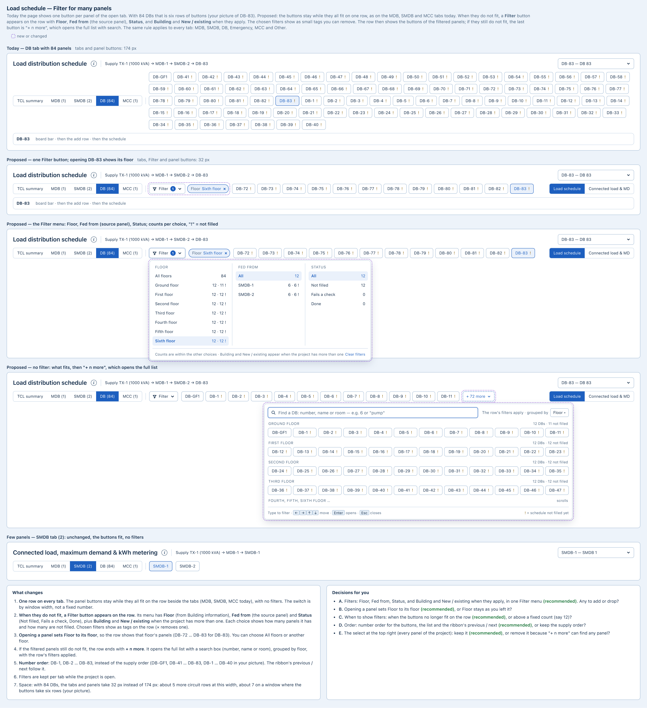

# UI UX proposal – Load schedule Filter for many panels (2026-11-18)

Status: **proposed**, waiting for the user's decisions A–E. Nothing is built.

Mockup: `docs/mockups/load-schedule-board-picker-mockup.html` (image: `load-schedule-board-picker-mockup.png`).

## Today

The user sent a picture of the DB tab of a project with 84 DBs (DB-83 open). The page shows one button per panel of the open tab (`.ls-panels` in `src/components/docs/LoadScheduleView.tsx`).
- 84 buttons wrap into six rows beside the tabs, so the schedule starts far down the page. At 1952 px wide the mockup measures 174 px for the tabs and buttons; the user's window shows six rows.
- The buttons follow the supply order (`scheduleGroups`, `src/model/scheduleGroups.ts`): DB-GF1, DB-41 … DB-83, DB-1 … DB-40, which is hard to scan.
- The same happens on any tab with many panels (SMDB, MCC, Emergency, Other).

## Proposed (every tab of the page)

First version: a ◀ panel ▾ ▶ picker. On the user's question ("keep source panel, floor and other applicable in the filter when getting bigger than one row") it became a Filter on the row:

1. **One row on every tab.** The panel buttons stay while they all fit on the row beside the tabs, as on the MDB, SMDB and MCC tabs today, with no Filter. The switch is by window width, not a fixed count.
2. **When they do not fit, a Filter button appears on the row.** Its menu has columns:
   - **Floor**, from Building information (`Board.level`);
   - **Fed from**, the source panel (`upstreamId`);
   - **Status**: Not filled (`incompleteSchedules`), Fails a check (`scheduleCheck`), Done;
   - **Building** and **New / existing** (`Board.existing`), only when the project has more than one.

   Each choice shows how many panels it has and how many are not filled, within the other choices. Chosen filters show as tags beside the button (× removes one); "Clear filters" resets.
3. **Opening a panel sets Floor to its floor**, so the row shows that floor's panels (DB-72 … DB-83 for DB-83).
4. If the filtered panels still do not fit, the row ends with **+ n more**. It opens the full list: a search box (number, name or room), grouped by floor, with the row's filters applied, the "!" marks, and keys (type, arrows, Enter, Esc).
5. **Number order** (DB-1, DB-2 … DB-83) for the buttons, the list and the ribbon's previous / next.
6. Filters are kept per tab while the project is open.
7. Space: 174 px → 32 px at 1952 px wide, about 5 more circuit rows; about 7 on the user's window.

## Decisions for the user

- **A.** Filters: Floor, Fed from, Status, and Building and New / existing when they apply, in one Filter menu (recommended). Any to add or drop?
- **B.** Opening a panel sets Floor to its floor (recommended), or Floor stays as you left it?
- **C.** When to show the Filter: when the buttons no longer fit on the row (recommended), or above a fixed count (say 12)?
- **D.** Order: number order for the buttons, the list and the ribbon's previous / next (recommended), or keep the supply order?
- **E.** The select at the top right (every panel of the project): keep it (recommended), or remove it because "+ n more" can find any panel?

## Build steps (after approval)

1. The Filter menu, tags, fit measurement on the `.ls-nav` row, "+ n more" list, number order, and tests. Screen only: the data and exports do not change.
