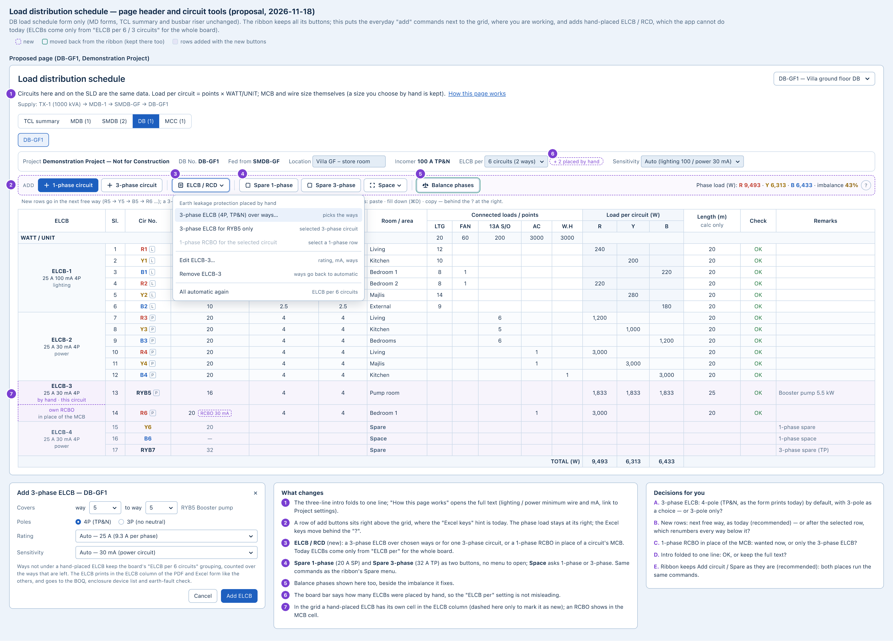

# UI UX proposal – Load schedule circuit tools and ELCB / RCD (2026-11-18)

Status: **mockup only, waiting for the user's decisions** (A–E below). Nothing is built.

Mockup: `docs/mockups/load-schedule-circuit-tools-mockup.html` (image: `load-schedule-circuit-tools-mockup.png`).

## Today

The user sent a picture of the DB load distribution schedule (DB-GF1) and asked for a redesign: there is no option on the page to add a circuit, a 3-pole ELCB / RCD, a 3-phase spare or a 1-phase spare.

- Add circuit (menu: 3-phase circuit) and Spare (menu: Space, 3-phase spare, 3-phase space) are only on the ribbon, Load schedule tab → Circuits and loads, since v2.109 (PR 535). The 3-phase and space choices sit behind the button's arrow. The page has no add buttons; the empty grid says "use Load schedule → Add circuit".
- ELCBs come only from the board setting "ELCB per" (6 circuits, 3 circuits, none), applied to the whole board (`elcbGroups`, `src/calc/loadSchedule.ts`). There is no way to put an ELCB on chosen ways, give a 3-phase circuit its own ELCB, or fit a 1-phase RCBO. `Feeder.rcdMa` exists but the schedule does not set it.
- The intro is three lines of text above the tabs on every visit.

## Proposed (DB form only; MD forms, TCL summary and busbar riser unchanged)

1. The intro folds to one line; "How this page works" opens the full text.
2. A row of add buttons right above the grid, where the "Excel keys" hint is now: **1-phase circuit**, **3-phase circuit** · **ELCB / RCD** (menu) · **Spare 1-phase** (20 A SP), **Spare 3-phase** (32 A TP), **Space** (menu: 1-phase, 3-phase) · **Balance phases**. Phase load and imbalance stay at the right; the Excel keys hint moves behind a "?". The ribbon keeps its buttons; both run the same commands (`addCircuit`, `addSpareWay`, `balancePhases`).
3. **ELCB / RCD** (new data): a 3-phase ELCB over chosen ways, a 3-phase ELCB for the selected 3-phase circuit only, or a 1-phase RCBO in place of the selected circuit's MCB. Edit, remove, and "All automatic again". Dialog: ways from–to, poles (4P TP&N default, 3P), rating Auto (from the largest phase current, `STANDARD_ELCB_A`) or chosen, sensitivity Auto (lighting / power setting, design rules) or chosen.
4. Ways not under a hand-placed ELCB keep the board's "ELCB per" grouping, counted over the ways that are left. The board bar shows "+ n placed by hand".
5. In the grid a hand-placed ELCB has its own cell in the ELCB column; an RCBO shows in the MCB cell. Both print in the ELCB column of the PDF and Excel form and count in the BOQ, the enclosure device list and the earth-fault check (`rcdOf`).

## Decisions for the user

- **A.** 3-phase ELCB: 4-pole (TP&N, as the form prints today) by default with 3-pole as a choice, or 3-pole only?
- **B.** New rows in the next free way, as today (recommended), or after the selected row (renumbers every way below it)?
- **C.** 1-phase RCBO in place of the MCB: now, or only the 3-phase ELCB first?
- **D.** Intro folded to one line: OK, or keep the full text?
- **E.** Ribbon keeps Add circuit / Spare as they are (recommended).

## Suggested build steps (after approval)

1. Page add buttons (items 1, 2): screen only, the commands already exist.
2. Hand-placed ELCB / RCBO (items 3–5): `Board.elcbs` (ways, poles, rating, mA) and the RCBO on the feeder; `elcbGroups` takes them first; ELCB column, PDF, Excel form, BOQ, enclosure and earthing follow; tests for the grouping, ratings and exports.
