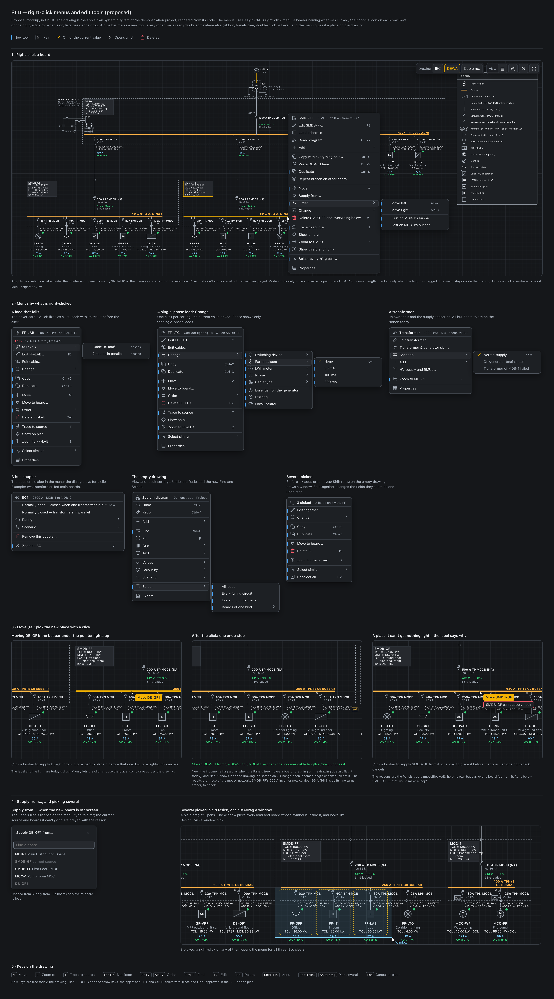

# UI UX proposal – SLD right-click menus and edit tools (2026-11-18)

Status: **approved 2026-11-18 with the five recommended answers** ("Yes, go ahead"): steps 1–4 in order; Shift+drag draws the window and a plain drag keeps panning; Move (M) of a board is done at once with Ctrl+Z; Undo and Redo only on the empty-drawing menu; the "len?" mark shows on the SLD (screen only). Being built, one PR per step.

Progress: Step 1 (menus with today's tools; Zoom to, Order, Copy and Duplicate, Change, Rename, Quick fix list) is in PR 693 (v2.204). As built: Duplicate names the copies by the "-2" rule (SMDB-FF-2, DB-GF1-2), as a paste without a rename; Paste follows the ribbon's rule (any board but the copied one); Properties also brings a hidden inspector back.

On 2026-11-18 the user asked which edit tools could be added on the SLD drawing, such as a right-click menu with Move and other operations, and asked for a mockup. The SLD ribbon proposal had listed "a right-click menu on the SLD" as a later idea.

Mockup: `docs/mockups/sld-right-click-menu-mockup.html` (image: `sld-right-click-menu-mockup.png`). The drawing in it is the app's own system diagram of the demonstration project, rendered from the code, not a screenshot. The menus use the look of Design CAD's right-click menu (`CadMenu`).

Related: [[UI UX proposals - 2026-11-12 - SLD ribbon]] (Trace, Find and Duplicate, approved), [[UI UX proposals - 2026-11-16 - CAD right-click menu look and order]] (the menu look and order reused here) and [[UI UX proposals - 2026-11-11 - Context-aware right-click menus]] (the rule that every row needs a working tool).

## Today

Main at v2.203. The system diagram is `SystemDiagram` (`src/components/SystemDiagram.tsx`). A right-click on it opens no menu of the app's own: the desktop app shows nothing, and a browser shows its own menu.

| What | How it works today |
|---|---|
| Select | Click a board or a load. One thing at a time. |
| Edit | Double-click or F2: the board edit dialog or the feeder form. Also the ribbon's Edit. |
| Move | Press on a load, a board or an incomer and drag it to a busbar (supply it from there) or onto a load (place it before that one). `startPick` → `applyMove` (`src/model/sldEdit.ts:619`): one undo step, no question. A board can also be dragged into another sheet's outline. |
| Cable | Click the cable text: size, runs, cores, type and length (`saveCable`). |
| Quick fix | The hover card of a failing load shows fix chips (`quickFixes`). |
| Delete | Delete key or the ribbon's Delete. It asks first. |
| Copy and paste | Ctrl+C / Ctrl+V and the ribbon: a board with everything below it. Loads can't be copied. |
| Bus coupler | A click opens its dialog: operation, rating, remove. |
| View | Zoom, pan, fit, grid and text detail on the canvas toolbar and keys. |

The **Panels tree** has a right-click menu, but the drawing doesn't: Open on the SLD, Properties…, Load schedule, Add feeder / load…, Add sub-board…, Move under… (a searchable list that says why a board can't go somewhere), Incomer length checked, Copy with everything below, Outgoing cable type, Paste here and Delete…. Tab / Shift+Tab indent and outdent there, and Alt+↑ / ↓ reorder.

What the drawing is missing:

1. No right-click menu. The work happens on the drawing, but most commands are on the ribbon, in the Panels tree or on the keyboard.
2. One thing at a time. Several loads can only be changed together through Changes → Bulk edit, which records a modification with a reason.
3. Moving needs a drag across the drawing. When the new board is off screen, that is slow. The Panels tree has the list; the drawing doesn't.
4. A load can't be copied or duplicated. Only boards can.
5. Order along a busbar: only by dragging onto another load. The Panels tree can reorder boards (Alt+↑ / ↓); the drawing can't.
6. **A gap found while scoping:** a board moved by the drag on the drawing does not get its incomer length flagged to check. Move under… in the Panels tree does (`moveBoard`, `src/model/moveBoard.ts`, sets `lengthToCheck`; `applyMove` doesn't). The flag only shows in the Panels tree ("len?"), not on the SLD.

Not proposed: **free positions.** The SLD is drawn from the supply tree (`layoutSystem`, `src/diagram/layout.ts`). A board's place follows its source and its order on that busbar. So "move" means "supply it from another board" or "another place on the same busbar". Dragging a board to any point would need a stored hand layout, and the drawing would stop redrawing itself. That stays a later idea, with a tidy layout. Rotate, mirror, align, stretch and scale don't apply to the SLD.

## Proposal

### How the menus work

- A right-click selects what is under the pointer and opens its menu. Shift+F10 or the menu key opens it for the selection.
- The look and keys of Design CAD's menu (`CadMenu`): a header naming what was clicked, the ribbon's icon on each row, keys on the right, a tick for what is on or the current value, lists beside their row. Up / Down, Right / Left, Enter, Esc and a letter work. The menu stays inside the drawing (`cadMenuPlace`).
- The order of Design CAD's object menus: header, the kind's own tools, copy, modify, view, select, Properties.
- Rows that don't apply are left off, not greyed. For example, Paste shows only while a board is copied, and Incomer length checked only when the length is flagged.
- In the tables, **New** means a tool that does not exist yet and is built with the menu. Every other row works today somewhere else; the menu only gives it a place on the drawing.

### A board

Right-click a board's busbar or box, or its incomer. Example in the mockup: **SMDB-FF** · SMDB · 250 A · from MDB-1.

| Row | Key | Today |
|---|---|---|
| Edit SMDB-FF… | F2 | double-click, F2, ribbon Edit |
| Load schedule | | double-click the circuit summary; Panels tree |
| Board diagram | Ctrl+2 | the Board tab |
| Add ▸ Load…, Motor…, Solar PV…, EV charger…, Feeder cable…, Sub-board… | | ribbon Add load and Boards; Panels tree |
| Copy with everything below | Ctrl+C | ribbon, keys |
| Paste DB-GF1 here | Ctrl+V | ribbon, keys (only while a board is copied) |
| Duplicate | Ctrl+D | **New** (approved in the SLD ribbon plan) |
| Repeat branch on other floors… | | Build hierarchy → Repeat branch |
| Move | M | **New**: click-to-place (the drag stays) |
| Supply from… | | Panels tree (Move under…) |
| Order ▸ Move left, Move right, First on MDB-1, Last on MDB-1 | Alt+← / Alt+→ | **New** on the drawing (`reorderBoard` exists) |
| Change ▸ Rename…, Outgoing cable type ▸, Incomer length checked | | Rename… **New** for one board (`renamePanels` exists); the other two in the Panels tree |
| Delete SMDB-FF and everything below… | Del | Delete key, ribbon |
| Trace to source | T | **New** (approved in the SLD ribbon plan) |
| Show on plan | | ribbon |
| Zoom to SMDB-FF | Z | **New** key (the results drawer already centres a board) |
| Show this branch only | | **New** |
| Select everything below | | **New** |
| Properties | | the inspector |

### A load

Example: **FF-LAB** · Lab · 50 kW · on SMDB-FF, drawn failing (its length raised for the example).

| Row | Key | Today |
|---|---|---|
| Quick fix ▸ the fixes, each with its result (passes / still to check) | | the hover card's chips; **New** place |
| Edit FF-LAB… | F2 | double-click, F2 |
| Edit cable… | | click the cable text |
| Change ▸ Switching device ▸, Earth leakage ▸, kWh meter ▸, Phase ▸ (single-phase loads), Cable type ▸, Essential (on the generator), Existing, Local isolator | | **New**: one click each; today the edit dialog (switching device also from Devices) |
| Copy | Ctrl+C | **New** for loads |
| Duplicate | Ctrl+D | **New** |
| Move | M | **New** |
| Move to board… | | **New** list (the drag exists) |
| Order ▸ | Alt+← / Alt+→ | **New** on the drawing |
| Delete FF-LAB | Del | Delete key, ribbon |
| Trace to source | T | **New** |
| Show on plan | | ribbon |
| Zoom to FF-LAB | Z | **New** key |
| Select similar ▸ Same load type on SMDB-FF, Same load type everywhere, Every failing circuit | | **New** |
| Properties | | the inspector |

### A transformer and a bus coupler

- **Transformer** (MDB-1's, 1000 kVA): Edit transformer… (double-click today), Transformer & generator sizing (the study page), Scenario ▸ (Normal supply, On generator (mains lost), Transformer of MDB-1 failed), Add ▸ (Generator + ATS, Generator + interlocked ACBs, Bus coupler / tie), HV supply and RMUs…, Zoom to (**New** key), Properties. All but Zoom to are on the ribbon today.
- **Bus coupler** (BC1): Normally open — closes when one transformer is out / Normally closed — transformers in parallel (ticked), Rating ▸, Scenario ▸, Remove this coupler…, Zoom to. The first four are in the coupler's dialog today; the dialog stays for a click.

### The empty drawing

Undo, Redo, Add ▸ (Transformer, Meter cabinet, HV supply and RMUs…), Find… (Ctrl+F, **New**, approved in the SLD ribbon plan), Fit, Grid ▸, Text ▸, Values ▸, Colour by ▸, Scenario ▸, Select ▸ (All loads, Every failing circuit, Every circuit to check, Boards of one kind ▸; **New**), Show everything (only while one branch is shown alone; **New**), Export….

### Several picked (New)

- **Picking:** Shift+click adds or removes. Shift+drag on the empty drawing draws a window, which picks every load and board whose symbol is inside it. A plain drag still pans. Esc clears. A right-click on any picked item opens the menu for all of them.
- **Menu**, example "3 picked · 3 loads on SMDB-FF": Edit together…, Change ▸ (for all; a tick only where all agree), Copy, Duplicate, Move to board…, Delete 3…, Zoom to the picked, Select similar ▸, Deselect all (Esc).
- **Edit together…** opens one dialog with the fields the picked share; mixed values are blank and left as they are. Before applying, it lists what changes and any check that would start failing (the preview of Changes → Bulk edit: `previewBulkEdit`, `introducedIssues`, `src/model/bulkEdit.ts`). It applies as one undo step, without the modification record that Changes keeps.

### The new tools behind the rows

1. **Move (M).** Choose Move, or select and press M. A label follows the pointer ("Move DB-GF1", today's drag label). A busbar or a load it can go to lights up as during a drag. Over a place it can't go, nothing lights and the label says why, with the Panels tree's reasons (`moveBlocked`): "SMDB-GF can't supply itself" over its own busbar, "… is below SMDB-GF — that would make a loop" over a board fed from it. A click places it as one undo step. Esc or a right-click cancels. The top bar names what moved, from where to where, and that Ctrl+Z undoes it.
2. **Supply from… / Move to board….** The Panels tree's list opens beside the menu: type to filter, the current source and blocked boards greyed with the reason. For when the new board is off screen. It is also the way into an end board such as DB-GF1: the system diagram draws an end board without its busbar, so pointing at it places the item before that board's way.
3. **Order ▸.** Move left / right (Alt+← / Alt+→) and First / Last on the busbar. Boards use `reorderBoard`; loads use `applyMove` with a `before` target.
4. **Copy and Duplicate a load; Duplicate a board.** A copied load pastes at the end of the board picked, or before the load picked. Duplicate puts the copy right after the original, with the next free number. A board is renamed by the paste rule (`suggestRename`).
5. **Change ▸.** One click per setting, with the current value ticked; each change is one undo step and uses the same fields as the edit dialog: `device`, `rcdMa`, `kwhMeter`, `phase`, `cableType`, `essential`, `existing`, `localIsolator`.
6. **Rename… (one board).** A small box at the board: the new name and how many references change; `renameProblems` blocks duplicates.
7. **Quick fix ▸.** The hover card's fixes in a list. Each shows its result before the click.
8. **Zoom to (Z).** Centres the item, as the results drawer's centring does.
9. **Show this branch only.** Everything not fed from the board is dimmed, as the generator scenario dims the boards that lose supply. Esc or Show everything ends it.
10. **Select tools.** Select everything below, Select similar ▸ and the empty drawing's Select ▸ fill the new several-picked selection.
11. **Trace (T) and Find (Ctrl+F)** are approved in the SLD ribbon plan (step 3). They join the menus when they are built.
12. **Fix for the gap.** A board moved on the drawing gets its incomer length flagged, as in the Panels tree. A small "len?" mark next to that incomer's cable text shows it on the SLD (on screen only, never printed). Change ▸ Incomer length checked clears it.

New keys on the drawing: M, Z, T (with Trace), Ctrl+D, Ctrl+F (with Find), Alt+← / Alt+→, Shift+F10. They are free today: the drawing uses + − 0 F G and the arrows (`viewKey`), the app uses V and H.

The **Board tab** (`SingleLineDiagram` / `BoardSheetView`) gets the load menu and Change ▸ for its ways, and the board menu for its sub-boards.

## Steps (one PR each, after approval)

1. **Menus with today's tools** on the system diagram: board, load, transformer, bus coupler and empty-drawing menus. `CadMenu` moves to a shared place. The rows come from a pure `sldMenu.ts`, with a test that every row runs a real action. Also the small new tools: Zoom to (Z), Order ▸, Copy and Duplicate, Change ▸, Rename…, Quick fix ▸.
2. **Move (M)** and Supply from… / Move to board… on the drawing, the incomer length flag for drawing moves and the "len?" mark.
3. **Several picked:** Shift+click, the Shift+drag window, the several-picked menu, Edit together…, and the select tools.
4. **Show this branch only** and the Board tab's menus.

Trace and Find are built under the SLD ribbon plan's step 3 and join the menus then.

## Decisions (my recommendation first)

1. **Build order:** steps 1–4 as listed / Move (step 2) first.
2. **Window select:** Shift+drag on the empty drawing, and a plain drag keeps panning / a plain drag selects, and Space or the Pan tool pans.
3. **Move (M) of a board:** done at once with Ctrl+Z, as the drag does today / ask "Supply DB-GF1 from SMDB-FF?" first, as the Panels tree does.
4. **Undo and Redo:** on the empty-drawing menu only, so the object menus stay shorter / on every menu, as in Design CAD.
5. **"len?" mark on the SLD:** show it on screen / Panels tree only.
